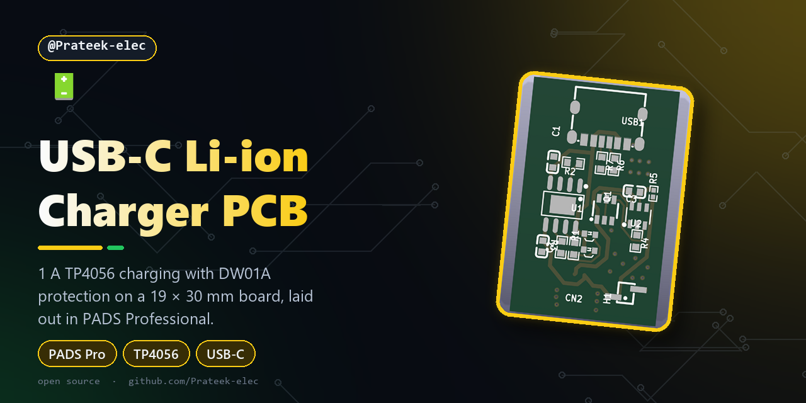
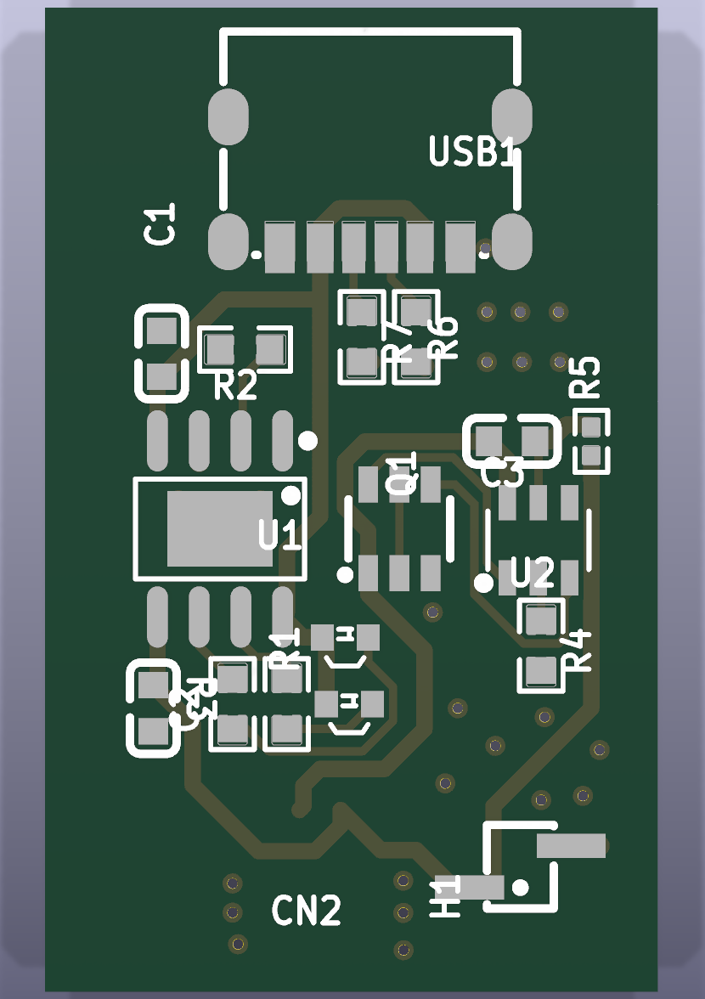
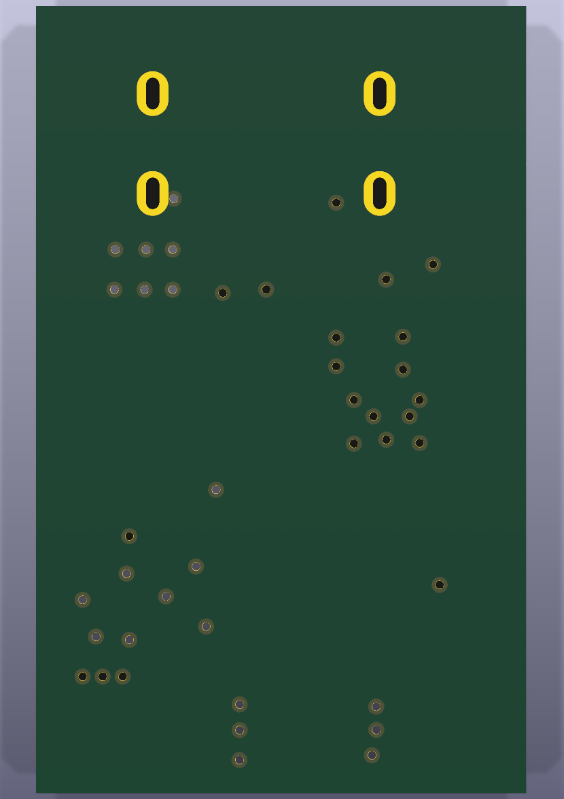

<div align="center">



**A 19 × 30 mm USB-C charger and protection board for single-cell Li-ion / LiPo batteries: 1 A charging, with over-charge, over-discharge and short-circuit protection.**


</div>

---

## The board

<table>
<tr>
<td width="50%" align="center"><br/><sub><b>Top:</b> USB-C in at the top, TP4056 (U1) on the left, DW01A (U2) and FS8205A (Q1) protection on the right, battery connector at the bottom</sub></td>
<td width="50%" align="center"><br/><sub><b>Bottom:</b> ground pour, stitching vias and the USB-C shell tabs</sub></td>
</tr>
</table>

<sub>Rendered from the design files. The footprints have no 3D models, so parts show as their pads.</sub>

## How it works

```text
 USB-C 5 V ──► TP4056 ──► BAT+ ─────────────────────────────► battery (+)
   CC1/CC2      │  1 A CC/CV to 4.2 V                          
   5.1 kΩ ↓     ├─ CHRG LED  (charging)                       
                └─ STDBY LED (done)                            
                                                               
 battery (−) ──► FS8205A dual MOSFET ──► BAT− / output (−)
                    ▲ gates
                 DW01A protection IC (watches cell voltage and current)
```

- **Charging (U1, TP4056):** a linear charger with constant-current then constant-voltage charging to 4.2 V. The 1.2 kΩ PROG resistor (R2) sets the charge current to **1 A** (I = 1200 / R<sub>PROG</sub>). Two LEDs show *charging* and *done*.
- **Protection (U2 DW01A + Q1 FS8205A):** the DW01A watches the cell and switches the low-side MOSFET pair off on over-charge (~4.3 V), over-discharge (~2.4 V), over-current and short circuit. The 100 Ω / 100 nF pair (R5, C3) filters its supply.
- **USB-C done right (R6, R7):** 5.1 kΩ pull-downs on both CC pins mark the board as a power sink, so **USB-C-to-C chargers will actually supply 5 V**. Many cheap USB-C charger boards leave these out and only work with A-to-C cables.
- **Connectors:** JST GH 1.25 mm for the battery (CN2), and a 1.27 mm header (H1) for the protected output.

## Specs

| | |
|---|---|
| **Input** | 5 V over USB Type-C (A-to-C and C-to-C cables) |
| **Battery** | 1 cell Li-ion / LiPo, 4.2 V full charge |
| **Charge current** | 1 A (change R2 to adjust: 2 kΩ ≈ 580 mA, 10 kΩ ≈ 130 mA) |
| **Protection** | Over-charge, over-discharge, over-current, short circuit |
| **Board** | About 19 × 30 mm, 2 layers, all parts on the top side |
| **Parts** | 18, see [BOM.csv](BOM.csv) |

## Files

| Path | What it is |
|---|---|
| [`pads/usb-c-charger.asc`](pads/usb-c-charger.asc) | Board in **PADS ASCII** (opens in PADS / PADS Professional, imports into Altium and KiCad) |
| [`pads/usb-c-charger-schematic.txt`](pads/usb-c-charger-schematic.txt) | Schematic in **PADS Logic ASCII** |
| [`pads/library-*.c`, `library-*.d`](pads/) | The schematic symbols and PCB footprints used |
| [`kicad/usb-c-charger.kicad_pcb`](kicad/usb-c-charger.kicad_pcb) | The board converted to KiCad, to view and edit for free |
| [`BOM.csv`](BOM.csv) | Bill of materials with what each part does |

The schematic was captured in EasyEDA Pro and the board laid out in PADS Professional.

> **Before ordering:** the KiCad conversion has no board outline (Edge.Cuts), so draw one around the copper pour or generate Gerbers from the PADS file. Check the TP4056's thermal pad is soldered: at 1 A it dissipates up to ~1 W.

## License

[MIT](LICENSE) © Prateek Sarkar

---

<div align="center">

**If this saved you a design, give it a ⭐.** More boards: [github.com/Prateek-elec](https://github.com/Prateek-elec)

</div>
